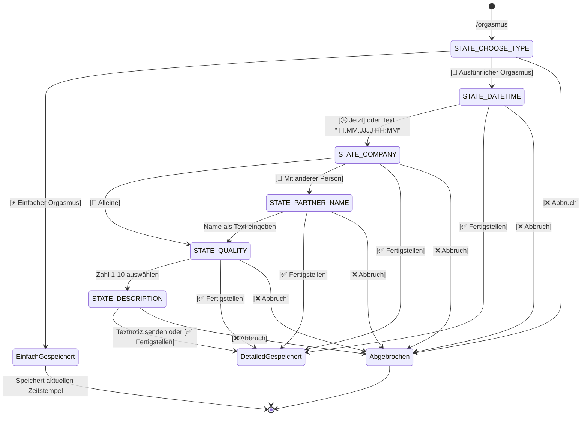

# 📊 Orgasmus Tracker Telegram Bot

Ein robuster, produktionsreifer und privater Telegram-Bot in Python zur Erfassung und Auswertung persönlicher Orgasmus-Protokolle. Entwickelt mit **python-telegram-bot (v21+)**, zustandsbehafteten Konversationen (**ConversationHandler**), lokaler **SQLite**-Persistenz, vollständiger **Docker**-Containerisierung und automatisierter CI/CD-Pipeline zur **GitHub Container Registry (ghcr.io)** via GitHub Actions.

---

## ✨ Features & Highlights

- **🔒 Höchste Privatsphäre & Sicherheit:**
  - Strenger Whitelist-Schutz über `ALLOWED_USER_IDS`: Nur explizit autorisierte Telegram-User-IDs können mit dem Bot interagieren.
  - Alle Daten verbleiben lokal in deiner eigenen SQLite-Datenbank (keine Drittanbieter-Cloud, kein externes Tracking).
- **💬 Intuitiver Konversations-Flow auf Deutsch (`/orgasmus`):**
  - **⚡ Einfacher Modus:** Speichert sofort mit einem Klick mit aktuellem Zeitstempel.
  - **📝 Ausführlicher Modus:** Erfasst schrittweise Datum/Uhrzeit (mit Schnellauswahl *Jetzt*), Begleitung (*Alleine* oder *Mit anderer Person* + Name), Qualität (Skala *1 bis 10*) und Notizen.
  - **Globale Navigation:** In jedem Schritt stehen `✅ Fertigstellen` (speichert alle bisherigen Angaben) und `❌ Abbruch` (verwirft den Entwurf) bereit.
- **📜 Verlauf, Historie & Löschen (`/liste` oder `/letzte`):**
  - Listet die letzten 10 Einträge des anfragenden Nutzers chronologisch sortiert mit allen Details auf.
  - **Interaktive Löschfunktion:** Über den Button `🗑️ Einträge löschen` können Einträge mit Checkboxen (`⬜` / `☑️`) markiert und nach einer Sicherheitsabfrage endgültig gelöscht werden.
- **🐳 DevOps & Container-Ready:**
  - Schlankes Multi-Stage-fähiges `Dockerfile` basierend auf `python:3.12-slim`.
  - Ausführung unter dediziertem Non-Root-Benutzer (`appuser:10001`).
  - `docker-compose.yml` für 1-Klick-Bereitstellung mit persistentem Volume `./data:/app/data`.
  - Automatische GitHub Actions CI/CD Pipeline für Build, Test & Push zu `ghcr.io`.

---

## 🛠️ Tech Stack

- **Programmiersprache:** Python 3.12+
- **Telegram Bot Framework:** `python-telegram-bot` v21.10 (asynchron, `Application`, `ConversationHandler`, `CallbackQueryHandler`)
- **Datenbank:** `sqlite3` mit WAL-Modus (Write-Ahead-Logging) für hohe Performance und Thread-Sicherheit
- **Zeitzonen:** Python `zoneinfo` mit `tzdata` (Standard: `Europe/Berlin`)
- **Containerisierung:** Docker & Docker Compose
- **CI/CD:** GitHub Actions mit GHCR-Integration

---

## 📋 Datenbank-Schema (`entries`)

Die SQLite-Tabelle wird beim Start automatisch initialisiert:

| Spalte | Typ | Beschreibung |
| :--- | :--- | :--- |
| `id` | `INTEGER PRIMARY KEY AUTOINCREMENT` | Eindeutige Eintrags-ID |
| `user_id` | `INTEGER NOT NULL` | Telegram-ID des Nutzers |
| `type` | `TEXT NOT NULL` | `'simple'` oder `'detailed'` |
| `timestamp` | `TEXT NOT NULL` | Datum & Uhrzeit (`YYYY-MM-DD HH:MM`) |
| `company` | `TEXT NULL` | `'Alleine'` oder `'Mit anderer Person'` |
| `partner_name` | `TEXT NULL` | Name der Begleitung |
| `quality` | `INTEGER NULL` | Bewertung von `1` bis `10` |
| `description` | `TEXT NULL` | Optionale Notiz/Beschreibung |
| `created_at` | `TEXT NOT NULL` | ISO-8601 Zeitstempel der Erstellung |

Ein Index auf `(user_id, timestamp DESC, id DESC)` garantiert schnelle Abfragen für die Historie.

---

## 🚀 Schnellstart & Einrichtung

### 1. Bot bei Telegram anlegen (@BotFather)

1. Öffne Telegram und starte einen Chat mit [@BotFather](https://t.me/BotFather).
2. Sende den Befehl `/newbot` und vergib einen Namen und Benutzernamen (z.B. `MeinTrackerBot`).
3. Kopiere den erhaltenen **HTTP API Token** (z.B. `123456789:ABCdefGhIJKlmNoPQRsTUVwxyZ`).
4. *(Empfohlen)* Befehlsmenü bei BotFather einrichten:
   - Sende `/setcommands` an BotFather.
   - Wähle deinen Bot aus und sende folgende Zeilen:
     ```text
     orgasmus - Neuen Orgasmus erfassen (Einfach oder Ausführlich)
     liste - Die letzten 10 Einträge anzeigen
     hilfe - Befehlsübersicht und Hilfe
     abbrechen - Aktuellen Dialog abbrechen
     ```

### 2. Eigene Telegram User-ID herausfinden

Der Bot antwortet aus Sicherheitsgründen nur Nutzern in `ALLOWED_USER_IDS`. Du kannst deine ID auf zwei Wegen ermitteln:
- Schreibe dem Bot [@userinfobot](https://t.me/userinfobot) auf Telegram (er nennt dir deine ID sofort).
- **Oder:** Starte den Bot später und sende `/start`. Der Bot weist unberechtigten Zugriff ab und zeigt dir dabei direkt deine Telegram-ID im Chat an.

### 3. Umgebungskonfiguration (`.env`)

Erstelle eine `.env`-Datei basierend auf `.env.example`:

```bash
cp .env.example .env
```

Passe die Variablen an:

```env
# Dein Bot Token von @BotFather
TELEGRAM_BOT_TOKEN=123456789:ABCdefGhIJKlmNoPQRsTUVwxyZ

# Erlaubte User-IDs (kommagetrennt für mehrere Nutzer)
ALLOWED_USER_IDS=123456789

# Pfad zur SQLite-Datenbank (Standard für Docker: /app/data/tracker.db)
DB_PATH=/app/data/tracker.db

# Zeitzone (Standard: Europe/Berlin)
TZ=Europe/Berlin
```

---

## 🐳 Deployment mit Docker Compose (Empfohlen)

### 1. Datenverzeichnis vorbereiten
Erstelle das lokale Verzeichnis für die SQLite-Datenbank und stelle sicher, dass der Container Schreibrechte besitzt:

```bash
mkdir -p data
# Schreibrechte für den Non-Root-Container-User (UID 10001) vergeben:
chmod 777 data
```

### 2. Container starten
Starte den Bot im Hintergrund:

```bash
docker compose up -d --build
```

### 3. Logs einsehen & Status prüfen
```bash
docker compose logs -f
```

### 4. Container stoppen oder neustarten
```bash
# Stoppen
docker compose down

# Neustarten
docker compose restart
```

---

## 💻 Lokale Entwicklung & Tests (Ohne Docker)

Falls du den Bot direkt mit Python ausführen möchtest:

### 1. Virtuelle Umgebung anlegen & aktivieren
```bash
python3 -m venv .venv
source .venv/bin/activate
```

### 2. Abhängigkeiten installieren
```bash
pip install -r requirements.txt
```

### 3. Umgebung anpassen
Setze in deiner `.env` den Pfad zur lokalen Datenbank, z.B.:
```env
DB_PATH=./data/tracker.db
```

### 4. Tests ausführen
Das Projekt enthält eine umfassende Testsuite mit 28 Unit- und Integrationstests:

```bash
pytest -v
```

### 5. Bot lokal starten
```bash
python src/bot.py
```

---

## 🔄 CI/CD mit GitHub Actions & GitHub Container Registry (ghcr.io)

Die im Repository enthaltene Workflow-Datei [`.github/workflows/docker-publish.yml`](.github/workflows/docker-publish.yml) übernimmt vollautomatisch:
1. **Automatisierte Tests:** Führt bei jedem Push und Pull Request die gesamte Testsuite (`pytest`) auf Python 3.12 aus.
2. **Multi-Arch Docker Build & Push:**
   - Bei jedem Push auf den Branch `main` wird das Image gebaut und als `ghcr.io/<owner>/<repo>:latest` sowie mit dem aktuellen Git-Commit-SHA (`ghcr.io/<owner>/<repo>:sha-...`) veröffentlicht.
   - Bei Git-Tags (z.B. `git tag v1.0.0 && git push origin v1.0.0`) wird das Image mit SemVer-Tags versehen (`:1.0.0`, `:1.0`, `:v1.0.0`).
3. **Sicherheit:** Verwendet das eingebaute `GITHUB_TOKEN` mit `packages: write` Berechtigung – keine manuellen Secrets für GHCR erforderlich!

### Verwendung des veröffentlichten Images:
Passe in deiner `docker-compose.yml` einfach das Image an:

```yaml
services:
  orgasmus-tracker:
    image: ghcr.io/nilsee1/orgasmustracker:latest
    container_name: orgasmus-tracker-bot
    restart: unless-stopped
    env_file:
      - .env
    volumes:
      - ./data:/app/data
```

---

## 📖 Konversations-Ablaufdiagramm (`/orgasmus`)



---

## 💾 Datenbank-Backup & Wartung

Da alle Einträge in einer standardmäßigen SQLite-Datei liegen, ist die Sicherung trivial:

```bash
# Sicheres Live-Backup im laufenden Betrieb erstellen:
sqlite3 ./data/tracker.db ".backup ./data/tracker_backup_$(date +%Y%m%d_%H%M%S).db"
```

Oder einfach das `./data`-Verzeichnis in dein gewohntes Backup-System (z.B. BorgBackup, Restic, Syncthing) einbinden.

